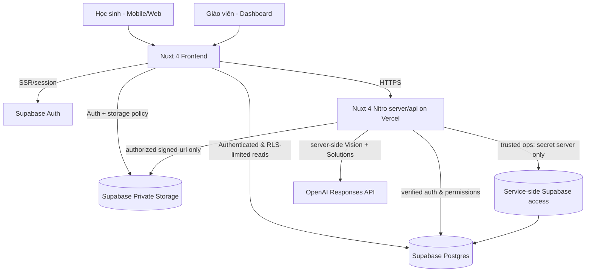
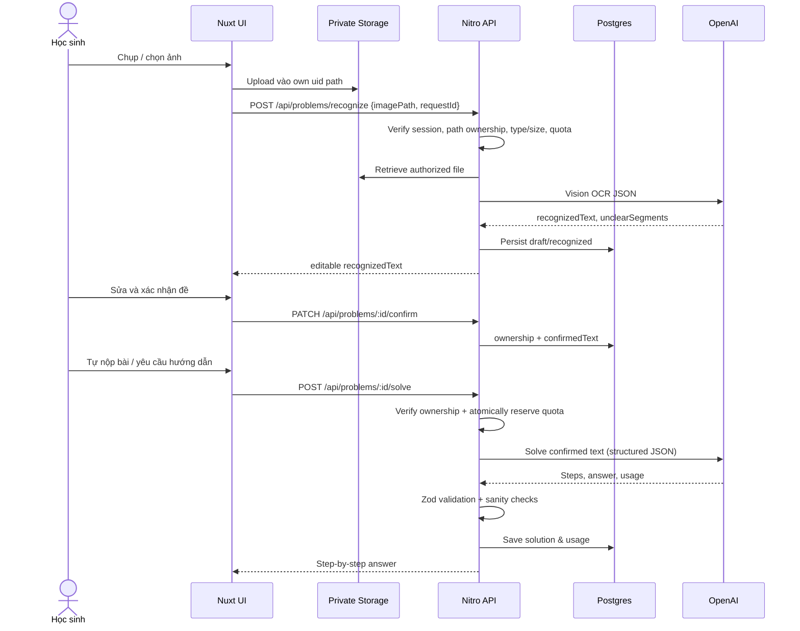

# Architecture — modular monolith

## System context (Mermaid)



## OCR + solve (sequence)



## Runtime boundaries
- Frontend: presentation, auth navigation, image compression, user-supplied input, permission-aware UX (not security boundary).
- Backend: verified identity, ownership/class checks, all paid AI calls, rate limits, privileged writes, error mapping, signed image access.
- Postgres: relational integrity, RLS, topic seed, quota counters. Never treat Supabase `service_role` as a user identity.
- Storage: private; owner-only direct client upload/read; teachers obtain image preview only through authorized short-lived signed URL issued by server.
- OpenAI: OCR and solving are separate provider calls; never trust model output as raw HTML/SQL/validated proof.

## Nuxt 4 folder convention
```text
app/
  app.vue
  pages/login.vue
  pages/student/index.vue
  pages/student/solve.vue
  pages/student/history.vue
  pages/teacher/index.vue
  pages/teacher/classes/[id].vue
  layouts/default.vue
  components/math/{ImageUploader,OCRReview,SolutionSteps,AnswerForm}.vue
  components/teacher/{ClassSummary,StudentProgress}.vue
  composables/{useProblem,useStudentHistory}.ts
  middleware/auth.ts
  assets/css/main.css
server/
  api/problems/recognize.post.ts
  api/problems/[id]/confirm.patch.ts
  api/problems/[id]/solve.post.ts
  api/problems/[id]/attempt.post.ts
  api/problems/index.get.ts
  api/teacher/classes/index.get.ts
  api/teacher/classes/[id]/students.get.ts
  api/teacher/classes/[id]/stats.get.ts
  api/images/[id].get.ts
  utils/{requireUser,authorize,quota,openai,errors}.ts
shared/
  schemas/{problem,solution,attempt}.ts
  types/api.ts
supabase/migrations/
tests/{unit,integration,e2e}/
nuxt.config.ts
```

## Failure model
Invalid/blur image -> request correction; model timeout -> retry message without leaking error; quota exhausted -> 429; unauthorized -> 403/404; provider unavailable -> 503; invalid model JSON -> retry once if safe then marked failed. Keep images private and preserve any student's confirmed text on failure.
