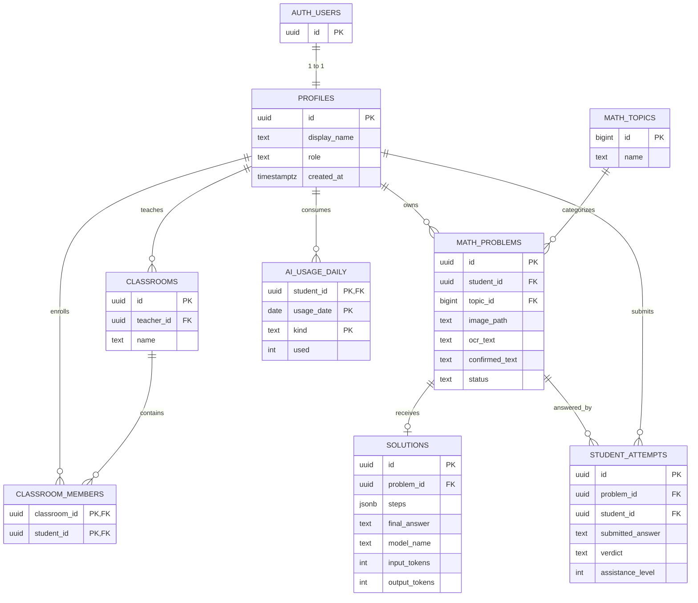

# Database Design — Supabase PostgreSQL

## ER diagram

## 7 domain tables + 1 operational
- `profiles` (auth.users.id PK): role `student|teacher`, display name, no birthdate/name requirement.
- `classrooms`: belongs to one teacher (`teacher_id`).
- `classroom_members`: many-to-many class/student. Teachers may own multiple classes; student may join multiple classes.
- `math_topics`: predefined Toán lớp 5 topics.
- `math_problems`: single owner; source image path optional; OCR extracted text + user-confirmed text + status.
- `solutions`: one initial AI solution per problem in MVP. If regeneration/versioning required, remove unique constraint **through planned migration**, not ad hoc.
- `student_attempts`: multiple attempts; verdict `ungraded|correct|incorrect|needs_review`; `assistance_level` distinguishes own work vs hint vs viewed solution.
- `ai_usage_daily`: atomic per-student per-day OCR and solve counters; quota reserve before spending token.

## Keys, indices, consistency
- Use UUID; authenticated user's ID derives from verified session not request body.
- `student_attempts` has composite FK `(problem_id,student_id)` referencing `math_problems(id,student_id)` to enforce owner match.
- Index student/time and class membership keys (included in migrations).
- Each teacher query scope classes by `teacher_id`; never filter only on a client-chosen classroom ID.
- `image_path` stores storage key, not signed/public URL.
- Do not use `verdict='correct'` as synonym for `solutions` generated successfully.

## Migrations
1. `supabase/migrations/20261010_000001_initial.sql`: 7 core tables + Supabase RLS + private bucket; derived from the pilot initial schema.
2. `supabase/migrations/20261010_000002_ai_quota.sql`: eighth table + atomic quota reservation RPC `public.consume_ai_quota` (only service-role may execute).

**Warning:** migrations provided are a starting point; inspect syntax in a disposable Supabase local/test project, test policies with `anon`, `student A`, `student B`, `teacher A`, `teacher B` and an unauthorized teacher. Do not apply blindly to live data.

## Class invite decision
MVP baseline assumes staff-assisted membership creation using authenticated, authorized server endpoints. If students must self-join with a code, first design an extra table `class_invites(id, classroom_id, token_hash, expires_at, uses_remaining)` with TTL, server validation, revocation and rate limits. Never use predictable 4-digit codes as sole authority for joining a class.

## RLS rules matrix

| Table | Student SELECT | Teacher SELECT | Writes |
|---|---|---|---|
| profiles | own | own + students in own classes | student may update `display_name`; role elevated only by admin |
| classrooms | classes joined | own classes | trusted server only |
| classroom_members | own memberships | members in own classes | trusted server only |
| math_topics | all authenticated | all authenticated | seed/admin only |
| math_problems | own | linked students only | trusted server only |
| solutions | own problem | linked students' problems | trusted server only |
| student_attempts | own | linked students only | trusted server only |
| ai_usage_daily | none direct | none direct | trusted atomic server routine |

Potential product choice: teacher should **not** see students' raw images unless educational need & access justification; preview requires server authorize+short lived signed URL. RLS controls SQL access; Storage has separate policy.
